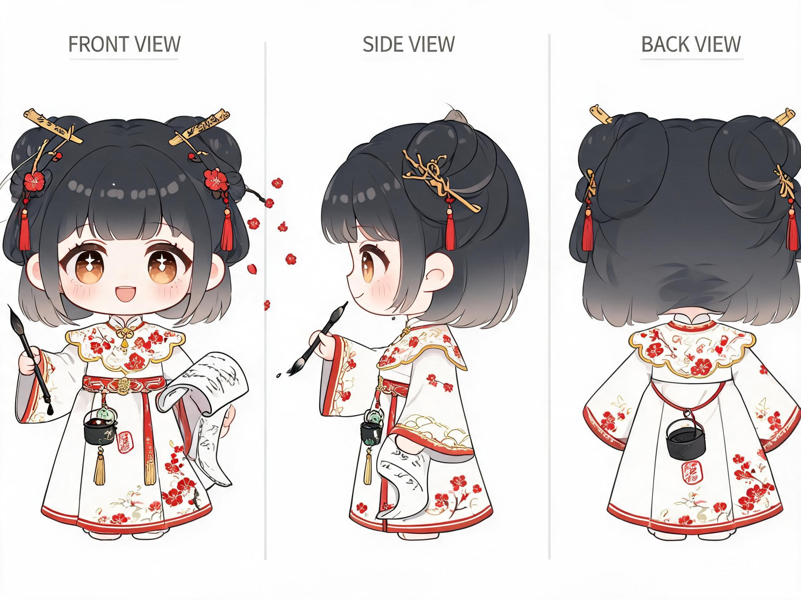

# poemly · 古典诗词大模型

> 基于 Qwen2.5-7B QLoRA 微调的古典诗词创作助手：三段式创作（先立意 → 作诗 → 逐联解意象）、用韵依平水韵、反抄袭防线、可选 RAG 知识库增强。24 天迭代 11 个版本，从 0.5B 小模型一路进化到 7B 现役版本，全程数据集自建、单卡可训。

## 目录

- [快速开始（下载现成模型）](#快速开始下载现成模型)
- [诗阁前端](#诗阁前端)
- [项目形象](#项目形象)
- [自己训练](#自己训练)
- [仓库结构](#仓库结构)
- [发展流程](#发展流程)
- [关键技术点](#关键技术点)

## 快速开始（下载现成模型）

模型体积 5.8GB，超过 GitHub 单文件 2GB 限制，Releases 中分为 3 个分卷，合并后即为完整 GGUF。

1. **下载**：到 [Releases](https://github.com/qzhi22603-code/poetry-ai/releases) 页面下载 `poemly-v21-Q6_K.gguf.part1 / .part2 / .part3` 三个文件，放在同一目录。

2. **合并分卷**：

   Windows（cmd）：
   ```bat
   copy /b poemly-v21-Q6_K.gguf.part1+poemly-v21-Q6_K.gguf.part2+poemly-v21-Q6_K.gguf.part3 poemly-v21-Q6_K.gguf
   ```

   macOS / Linux：
   ```bash
   cat poemly-v21-Q6_K.gguf.part1 poemly-v21-Q6_K.gguf.part2 poemly-v21-Q6_K.gguf.part3 > poemly-v21-Q6_K.gguf
   ```

3. **校验完整性**（可选但推荐）：合并后 SHA-256 应等于 Release 说明中给出的值。

4. **导入 ollama**（[ollama.com](https://ollama.com) 下载安装）：
   ```bash
   ollama create poemly-v21 -f Modelfile-v21
   ollama run poemly-v21
   ```
   `Modelfile-v21` 已内置系统人设与生成参数，导入即可获得完整的 poemly 行为。之后也可把 Modelfile 第 8 行改为 `FROM poemly-v21:latest` 方便重装。

## 诗阁前端

`Poemly诗阁.html` 是 poemly 的聊天前端（浏览器打开即用），会话本地保存在 localStorage。

- 启动 `ollama serve` 后，前端**优先连接 RAG 代理**（`127.0.0.1:11499`，若你部署了 [RAG 增强模块](RAG/)），**代理不在时自动回退直连 ollama**（`127.0.0.1:11434`），普通用户无需任何额外部署。
- 直接双击 HTML 打开时，浏览器 Origin 为 `null`，需让 ollama 放行跨域：
  - Windows：设置环境变量 `OLLAMA_ORIGINS=*` 后重启 ollama；
  - 或改用本地静态服务器打开（默认跨域即放行）：`python -m http.server 8000`，然后访问 `http://localhost:8000/Poemly诗阁.html`。

RAG 增强模块（可选，进阶）：`RAG/rag_proxy.py` 提供混合检索（0.8 向量 + 0.2 二组词）与创作意图保护；`RAG/watchdog.py` 每 30 秒守护代理进程。需要自行构建向量库，见目录内说明。

## 项目形象

poemly 的 Q 版形象是一位执笔的古典少女：墨色渐变长发、金笔簪与红梅发饰、红云肩金线汉服，腰间挂墨桶与朱砂印章——文房四宝随身，落笔生花。



素材均在 `assets/mascot/`，点开即可下载：

| 文件 | 用途 |
|---|---|
| `mascot-turnaround.jpg` | 三视图设定稿（正 / 侧 / 背） |
| `mascot-avatar.png` | 512px 圆形头像（金环描边） |
| `mascot-standing.png` | 正面全身立绘 |
| `mascot-favicon.ico` | 多尺寸网页图标 |

诗阁前端会自动加载与 HTML 同目录的这三个素材文件（`poemly_favicon.ico` / `poemly_avatar.png` / `poemly_standing.png`）。想获得带形象的完整界面：下载 `Poemly诗阁.html` 后，把 `assets/mascot/` 里的素材按上面三个文件名放到同一目录即可；不放也不影响聊天，只是没有形象。

## 自己训练

三种路线任选：

### 路线 A：云端一键训练（推荐，成本约几元）

在 AutoDL 租一张 GPU（24GB 起步，40GB+ 更快），实例内执行：

```bash
bash cloud_v15/bootstrap_v21_new.sh
```

脚本自动完成：换源装依赖 → 拉取代码与数据集 → 下载基座模型 → 训练 → 合并 LoRA → 转 GGUF → Q6_K 量化。产物在 `cloud_v15/poemly-v21-Q6_K.gguf`，下载后按上面步骤导入 ollama。

### 路线 B：本地训练（自有 NVIDIA GPU）

```bash
pip install -r requirements.txt
python cloud_v15/train_v21.py     # 训练（显存自适应：40GB+ 走 bf16 LoRA，24GB/16GB/12GB 走 QLoRA，等效 batch 恒为 16）
python cloud_v15/merge_v21.py     # 合并 LoRA → 完整模型
# 再用 llama.cpp 的 convert_hf_to_gguf.py 转 GGUF，llama-quantize 做 Q6_K 量化
```

### 路线 C：只用数据集

`训练数据/poemly_sft_v21.json`（2250 条，v2.1 现役数据集）已在仓库中，格式为 `{"_system": 人设, "instruction": 输入, "output": 输出}` 三元组对话样本，覆盖三段式创作、主题泛化、起名反抄袭、事实问答、自由体裁等场景。可用任意 SFT 框架（trl / LLaMA-Factory 等）加载。

## 仓库结构

```
├── Poemly诗阁.html        # 聊天前端（RAG 优先 / ollama 直连回退）
├── Modelfile-v21          # ollama 导入配置（内置人设）
├── requirements.txt       # 本地训练依赖
├── assets/mascot/         # Q 版形象素材：三视图 / 头像 / 立绘 / favicon
├── cloud_v15/             # 训练管线：train_v21.py（训练）、merge_v21.py（合并）、
│                          # bootstrap_v21_new.sh（云端一键自举）等
├── RAG/                   # 检索增强代理 + 看门狗（可选模块）
├── 训练数据/               # 各版本数据集生成脚本与 JSON 数据
└── 迭代图谱.md            # 24 天 11 个版本的完整迭代记录
```

## 发展流程

| 版本 | 日期 | 关键变化 |
|---|---|---|
| v1.0 | 10.19 | QLoRA 首训 3019 条，loss 2.39→0.45，三段式精确收尾成型 |
| v1.1 | 10.20 | 检索增强 RAG 注入上下文，学会查资料作答 |
| v1.2/1.3 | 10.21 | 反抄袭树 1891 条，主题泛化 1963 条 + 原创短语 124 首 |
| v1.4 | 10.23 | 起名反抄袭 2043 条 + 身份样本 8 条 + 事实问答 12 条 |
| v2.0 | 10.31 | 跨代换脑：0.5B→7B（Qwen2.5），云训 21 分钟 loss 0.406，Q6_K 记忆 100% 移植 |
| v2.1 | 11.05 | 自由体裁补丁 207 条，2250 条全量重训 loss 0.37，Q6_K 5.8GB 本地部署，盲测全过 |

详细故事线见 [迭代图谱.md](迭代图谱.md)。

## 关键技术点

- **人设一致性**：推理时的 system prompt 必须与训练数据的 `_system` 字段逐字一致，否则模型行为漂移（曾因人设被截短而复现出抄录古人原句的退化）。
- **显存自适应训练**：`train_v21.py` 读取显卡显存自动选路线——≥40GB 走 bf16 LoRA + adamw_torch，24GB/16GB/12GB 走 QLoRA（4bit NF4 + paged_adamw_8bit），等效 batch 恒为 16。
- **反抄袭防线**：训练侧（反抄袭树 + 原创短语改写）与推理侧（RAG 创作意图保护：命中"写/来一 + 诗"则跳过知识注入）双重防线。
- **Blackwell 兼容**：RTX 5090 / RTX PRO 6000 等新卡需 CUDA 12.8+ 镜像，V100 不受 bitsandbytes 支持。

## 致谢与说明

- 基座模型：[Qwen2.5-7B-Instruct](https://huggingface.co/Qwen/Qwen2.5-7B-Instruct)（Apache 2.0）
- 创始人 / 训练者：Quanzhi（2026.10 – 至今）
