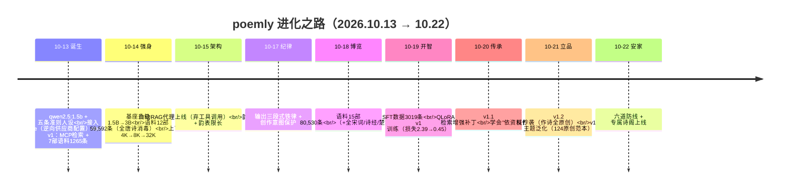
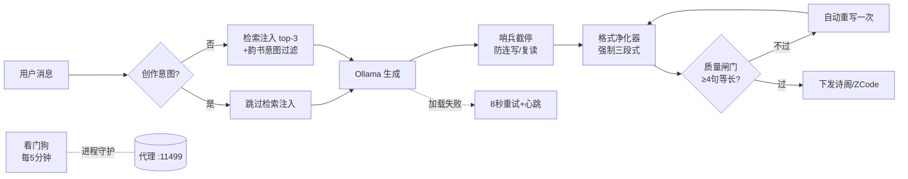

# poemly 迭代图谱

> 从一个会输出乱码的 1.5B 芽体，到住进"诗阁"的原创诗人——全程 10 天，七次换脑，六道防线。
> 创始人：Quanzhi · 基座：通义千问 Qwen2.5 · 引擎：Ollama · 训练：QLoRA

## 总览

## 版本谱系

| 版本 | 权重 ID | 核心变化 | 一句话画像 |
|---|---|---|---|
| v0 芽体 | —（qwen2.5:1.5b） | Modelfile 人设 + RAG 挂载 | 会写诗但满口乱码 |
| v0.5 | 51f8450bfc99 | 上下文修 4K→8K | 不乱码了，开始胡编韵部 |
| v0.9 | 89dd1fb17ce4 | 换 3B 基座 + 复读惩罚 | 江字不再"十一元"（有时） |
| v1.0 | 9013d4e1a7b1 | QLoRA 3019条×3轮 | 学会三段式与精确收尾 |
| v1.1 | c20028800fc2 | 检索增强补丁×2轮 | 懂得"依注入资料作答" |
| v1.2 | 75e0f3cd1236 | 反抄袭重构 1891条 | 真诗只用于默写/赏析 |
| **v1.3（现役）** | d7c2a72902d5 | 主题泛化 1963条 | 原创率：圈内≈100% 泛化4/5 |

## 能力成长线

| 维度 | 起点 | 现在 |
|---|---|---|
| 参数量 | 1.5B | 3.1B（Q8_0 部署） |
| 语料 | 0 | 15 部 80,530 条（≈百万字） |
| 检索延迟 | — | 0.3 秒（numpy 混合评分） |
| 上下文 | 2048 | 32,768 |
| 身份认知 | 自称 ChatGPT | poemly（创始人 Quanzhi） |
| 作诗字数 | 五七言不分 | 逐句 5/7 严格 |
| 收尾 | 复读刷屏 | 精确停止（六道防线兜底） |
| 抄袭 | 整首默写杨万里 | 圈内零抄袭，泛化 4/5 |

## 六道防线（代理 v8）

## 训练数据谱系

| 数据集 | 条数 | 构成 | 用途 |
|---|---|---|---|
| poems_pilot（金标准） | 34 | 手写原创范诗 | 风格之锚 |
| originals_v12 / hand2 | 68 | 手写原创（44+24） | 反抄袭范本 |
| originals_v13（蒸馏） | 24+ | deepseek 生成过三重质检 | 主题泛化 |
| 真诗通道 | 811 | 默写300 + 赏析211 + 出处300 | 教"创作≠背诵" |
| 韵部/体裁问答 | 950 | 韵表程序化生成 | 事实问答 |
| 检索增强 | 320 | 带检索上下文样本 | 依资料作答 |
| **v1.3 合计** | **1963** | 全部质检零容忍 | — |

## 故事线（按天）

- **D1（10.13）**：一句话起意——"我打算独立训练的 ai 模型叫 poemly"。当日完成接入 ZCode 与第一版 RAG；夜里第一次乱码事件。
- **D2（10.14）**：换脑 3B；全唐诗 5.7 万首入库消毒；半夜配置事故（供应商条目缺字段导致模型消失），逆向 ZCode 校验规则修复。
- **D3（10.15）**：发现 3B 调工具不可靠，架构转向自动注入代理；全宋词/诗经/楚辞入库。
- **D4（10.17）**：输出纪律立规；深夜"连写不停"首案告破（创作意图保护上线）。
- **D5（10.18-19）**：造数据三日——56 条试产 → 3019 条量产，全自动质检（字数/句数/韵部/查重）；QLoRA 首训两小时。
- **D6（10.20）**：v1.1 补丁（教它读注入资料）；抄袭案发（荷花抄杨万里）。
- **D7（10.21）**：反抄袭 v1.2/v1.3 连续两版；原创范本扩至 124 首；连写终局根治（三层限流）。
- **D8（10.22）**：格式净化器 + 质量闸门 + 看门狗；诊断出 ZCode 重压为病根，诗阁落成——poemly 有了自己的家。

## 致谢

poemly 由 **Quanzhi** 训练培育。基座：阿里通义 Qwen2.5-3B-Instruct。
训练框架 PyTorch/PEFT/bitsandbytes，转换 llama.cpp，引擎 Ollama，检索 bge-m3。
语料均来自公版：chinese-poetry、维基文库、rime-aca。
