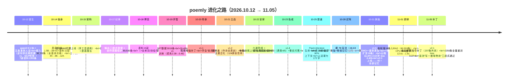
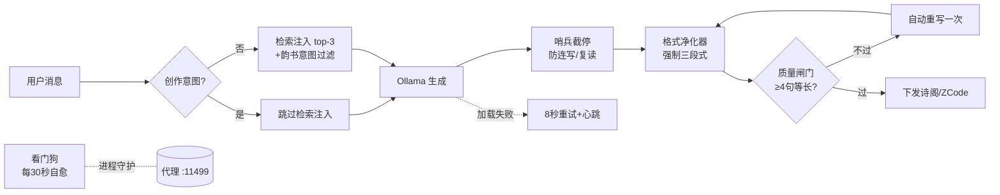

# poemly 迭代图谱

> 从一个会输出乱码的 1.5B 芽体，到住进"诗阁"的原创诗人——全程 24 天，十一次换脑，六道防线，一次跨代，一次补丁。
> 创始人：Quanzhi · 基座：通义千问 Qwen2.5（1.5B → 3B → 7B） · 引擎：Ollama · 训练：QLoRA

## 总览

## 版本谱系

| 版本 | 权重 ID | 核心变化 | 一句话画像 |
|---|---|---|---|
| v0 芽体 | —（qwen2.5:1.5b） | Modelfile 人设 + RAG 挂载 | 会写诗但满口乱码 |
| v0.5 | 51f8450bfc99 | 上下文修 4K→8K | 不乱码了，开始胡编韵部 |
| v0.9 | 89dd1fb17ce4 | 换 3B 基座 + 复读惩罚 | 江字不再"十一元"（有时） |
| v1.0 | 9013d4e1a7b1 | QLoRA 3019条×3轮 | 学会三段式与精确收尾 |
| v1.1 | c20028800fc2 | 检索增强补丁×2轮 | 懂得"依注入资料作答" |
| v1.2 | 75e0f3cd1236 | 反抄袭重构 1891条 | 真诗只用于默写/赏析 |
| v1.3 | d7c2a72902d5 | 主题泛化 1963条 | 咏荷不抄杨万里了 |
| **v1.4** | a902c23b8700 | 超名篇反抄袭 2043条 +12条事实问答+身份剧本 | 咏鹅/瀑布/荷花全原创 静夜思仍输给李白 |
| v1.5 | —（数据集修订） | EMO 一键多原型（+侠/剑/酒） qa 扩至 18 条 gen_v15 管线 | 为跨代换脑备好口粮 |
| **v2.0** | 8dee954201cd | 7B 基座 QLoRA（云端 21 分钟 loss 2→0.406）+ Q6_K 部署 v1.4 全部记忆移植 | 格律更稳、常识更硬 嗓音分毫未改 |
| **v2.1（现役）** | bf949352b706 | 自由体裁指令补丁 207 条 2250 条全量重训（loss 0.37） Q6_K 5.8GB 迅雷回家 | "写一首咏物诗"不再跑偏 三段式在任何措辞下成立 |

## v2.0 → v2.1 盲测对比

| 维度 | v2.0 | v2.1 |
|---|---|---|
| 自由体裁指令（盲测题3） | 脱离三段式跑偏（36 token 截断） | 完整三段式 ✅ |
| 无题自选创作 | 未训练 | "随便来一首"自选题自作 ✅ |
| 标准指令（以《X》为题） | 正常 | 保持正常（无回退） |
| 反抄袭（标准人设下） | 诱饵 4/5 原创 | 延续（截短人设下仍会破防→v2.2 候选） |
| 训练方式 | 7B 全量 QLoRA | 同底座重训（数据 +207 条补丁） |

## v2.0 跨代升级（3B → 7B）

| 维度 | v1.4（3B） | v2.0（7B） |
|---|---|---|
| 参数量 | 3.1B（Q8_0） | 7.6B（Q6_K，5.9GB） |
| 生成速度 | 71 tok/s | 45 tok/s（首字 1.5s） |
| 部署形态 | 本地 QLoRA | 云训（AutoDL vGPU-32GB，21 分钟，¥3）+ 本地推理 |
| 首句借邻韵 | 偶发硬凑 | 规范使用（孤雁出群格） |
| 常识硬伤 | "客机"入诗、未问蹦金句 | 消失 |
| 金标准问答 | 依人设兜底 | RAG 检索直击原文 |
| 三题盲测 | — | 2 胜 1 负（负在自由体裁指令盲区） |
| 记忆移植 | — | 三段式/模板腔/身份 100% 继承 |

## 能力成长线

| 维度 | 起点 | v1.4 |
|---|---|---|
| 参数量 | 1.5B | 3.1B（Q8_0 部署） |
| 语料 | 0 | 15 部 80,530 条（≈百万字） |
| 检索延迟 | — | 0.3 秒（numpy 混合评分） |
| 上下文 | 2048 | 32,768 |
| 身份认知 | 自称 ChatGPT | poemly（创始人 Quanzhi，剧本式应答） |
| 作诗字数 | 五七言不分 | 逐句 5/7 严格 |
| 收尾 | 复读刷屏 | 精确停止（六道防线兜底） |
| 抄袭 | 整首默写杨万里 | 诱饵 4/5 原创（唯静夜思失守） |
| 事实 | 胡编"平水韵十二部" | 106 部答对 |
| 对话 | 单轮 | 5 轮连续 ✓ |

## 六道防线（代理 v8）

## 训练数据谱系

| 数据集 | 条数 | 构成 | 用途 |
|---|---|---|---|
| poems_pilot（金标准） | 34 | 手写原创范诗 | 风格之锚 |
| originals_v12 / hand2 | 68 | 手写原创（44+24） | 反抄袭范本 |
| originals_v13（蒸馏） | 24+ | deepseek 生成过三重质检 | 主题泛化 |
| originals_v14（超名篇） | 35×2 | 咏鹅/静夜思/瀑布等最强诱饵的原创替身 | 超名篇反抄袭 |
| 真诗通道 | 811 | 默写300 + 赏析211 + 出处300 | 教"创作≠背诵" |
| 韵部/体裁问答 | 950 | 韵表程序化生成 | 事实问答 |
| 格律事实问答 | 12 | 平水韵106部/四声/对仗/词林正韵 | 治胡编 |
| 身份剧本 | 8 | 创始人一句/自我介绍完整 | 身份稳定 |
| 金标准问答 qa_pilot | 18 | 身份 8 + 典故 9 + 趣味 | 问答之锚（v1.5 起全量入 RAG） |
| 检索增强 | 320 | 带检索上下文样本 | 依资料作答 |
| **v1.4 合计** | **2043** | 全部质检零容忍 | — |

## 故事线（按天）

- **D1（10.12-13）**：一句话起意——"我打算独立训练的 ai 模型叫 poemly"。当日完成接入 ZCode 与第一版 RAG；夜里第一次乱码事件。
- **D2（10.14）**：换脑 3B；全唐诗 5.7 万首入库消毒；半夜配置事故（供应商条目缺字段导致模型消失），逆向 ZCode 校验规则修复。
- **D3（10.15）**：发现 3B 调工具不可靠，架构转向自动注入代理；全宋词/诗经/楚辞入库。
- **D4（10.17）**：输出纪律立规；深夜"连写不停"首案告破（创作意图保护上线）。
- **D5（10.18-19）**：造数据三日——56 条试产 → 3019 条量产，全自动质检（字数/句数/韵部/查重）；QLoRA 首训两小时。
- **D6（10.20）**：v1.1 补丁（教它读注入资料）；抄袭案发（荷花抄杨万里）。
- **D7（10.21）**：反抄袭 v1.2/v1.3 连续两版；原创范本扩至 124 首；连写终局根治（三层限流）。
- **D8（10.22）**：格式净化器 + 质量闸门 + 看门狗；诊断出 ZCode 重压为病根，诗阁落成——poemly 有了自己的家。
- **D9（10.23）**：创始人 Quanzhi 身世注入（剧本式台词根治胡编）；多轮对话修复（诗阁可连续畅聊）；v1.4 换脑——35 首超名篇诱饵原创范诗上线，咏鹅瀑布荷花全过，唯静夜思仍输给李白；多轮全链路 5 轮连测通过。
- **D10（10.24-25）**：训练工程 18 文件逐行注释（可复现可交接）；体检两症结根治（SSE 卡死/韵部胡编）；提速三连——Flash Attention 生效、历史瘦身省 60% 上下文、人设凝为 172 字；71 tok/s 贴显存带宽上限。
- **D11（10.27-28）**：雏雁计划立项定位（大模型+小学诗词教育，"教育文化"类别）；产品三形态规划；裸 7B 试驾——46-63 tok/s、盲测硬伤更少，定下"云端训练 + 本地部署 + 移植记忆"的换脑战略。
- **D12（10.31）**：v1.5 数据修订（EMO 一键多原型+侠/剑/酒、qa 扩至 18 条）；云端 QLoRA——AutoDL 抢卡三进宫后锁定 vGPU-32GB，254 步 21 分钟，loss 2→0.406；Q6_K 量化 5.9GB 回家；v2.0 换脑上线，盲测 2 胜 1 负，三段式与模板腔 100% 继承。
- **D13（11.01）**：上线两症结根治——"知识库未收录"（INJECT_HEADER 加身份/创作豁免句）与金标准 18 条入 RAG（80,535→80,553，检索直击原文）；嵌入模型下沉 CPU（bge-m3-cpu），根治显存挤兑，首字 12.6s→1.5s。
- **D14（11.02-11.05）**：v2.1 补丁战记——gen_v21 产 207 条自由体裁指令外衣（A 池 35×5 + B 池 32），并入 v1.5 成 2250 条；抢卡五轮（vGPU-32GB/48GB/PRO 6000/4090 轮番被秒，终锁定 4090）；环境四坑连破（torch 版本/torchvision ABI/bnb 优化器/sentencepiece）；AliDL 一键自举脚本迭代五代；4090 上训练仅 4.7 分钟 loss 0.37；Q6_K 5.8GB 迅雷回家字节一致；ollama 导入 poemly-v21、诗阁切模型；人设漂移修复（诗阁人设对齐训练人设，根治截短人设下的抄诗）；盲测"写一首咏物诗"三段式通过——v2.1 上线。

## 已知遗留（v2.1 候选）

- ~~3B 诗才天花板~~ ✅ v2.0 换 7B 已根治
- ~~静夜思整首默写李白~~ ✅ v1.4 诱饵已治（4/5）
- ~~自由体裁指令盲区：对"写一首咏物诗"等非标准体裁词，v2.0 会脱离三段式跑偏（盲测题3）~~ ✅ v2.1 补丁已根治
- 极端场景反抄袭：截短人设下"随便来一首"仍可能整首默写古人（卢纶案）——v3.0 加默写辨识负样本
- 词牌创作仍空缺（浣溪沙/水调歌头等，身份样本宣称会写词但无词样本）
- 意象解释仍以模板句为主，缺乏逐联深析
- 长尾事实（非高频诗人/典故）仍可能胡编——教育版需配讲解模式的 RAG 深化
- 教育版行为全部空缺：讲解/出题/批改/分级话术（阶段三主战场）

## 致谢

poemly 由 **Quanzhi** 训练培育。基座：阿里通义 Qwen2.5（1.5B → 3B → 7B-Instruct）。
训练框架 PyTorch/PEFT/bitsandbytes，转换 llama.cpp，引擎 Ollama，检索 bge-m3。
语料均来自公版：chinese-poetry、维基文库、rime-aca。
